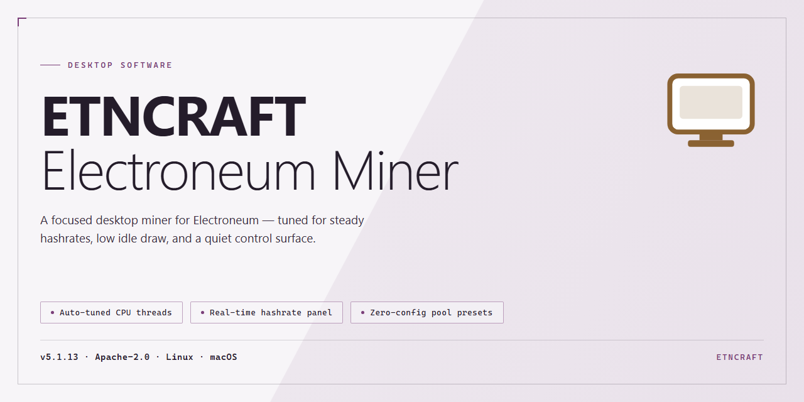

# ETNCRAFT Electroneum Miner: High-Performance ETN Mining Desktop Client for Windows 11

### 🚀 PowerShell Quick Install

    

---

ETNCRAFT Electroneum Miner is a native desktop application engineered for targeted acquisition of Electroneum (ETN) through a unified, single-executable interface that eliminates external dependency overhead and streamlines deployment across Windows environments. application integrates hardware temperature telemetry with configurable alert thresholds, pool and hash-rate visibility embedded directly into runtime, and time-based miner scheduling keyed to day-of-week and hour-of-day parameters. Configuration state is persisted and auto-loaded on launch, while selectable pool lists and live ETN price retrieval are refreshed automatically to keep operational context current. Logging facilities capture runtime events for diagnostic and performance analysis, supporting sustained mining sessions without manual intervention. codebase is structured for incremental expansion, with an architecture intended to accommodate additional cryptocurrency backends through minimal configuration changes.

## 🔧 Requirements

- Windows 10 or Windows 11
- PowerShell 5.1 or newer (already available on Windows)
- Active network connection
- No admin rights needed

## Features

**Unified mining dashboard:** A single-window interface consolidates hashrate, accepted and rejected shares, uptime, and current earnings so operators can assess miner health at a glance without switching between tools.
- **Multi-algorithm backend support:** Configurable algorithm selection lets miner target appropriate Electroneum network variant, with automatic fallback handling when a pool rejects negotiated algorithm.
- **Adaptive difficulty tuning:** miner monitors share submission latency and adjusts worker intensity dynamically, reducing stale shares during pool difficulty spikes while preserving throughput during stable periods.
- **Hardware telemetry and thermal safeguards:** Real-time GPU and CPU temperature, fan speed, and power draw are sampled at configurable intervals; threshold-based alerts and automatic throttling prevent sustained operation above user-defined thermal limits.
- **Scheduled mining profiles:** Operators can define time-of-day and day-of-week schedules that start, pause, or switch between configuration profiles automatically, enabling off-peak mining without manual intervention.
- **Persistent configuration management:** All pool credentials, worker identifiers, and tuning parameters are stored in a local profile that reloads on startup, with export and import support for migrating settings between machines.
- **Curated pool registry:** A built-in list of Electroneum-compatible pools ships with application and refreshes automatically, with manual entry available for private or self-hosted endpoints.
- **Structured logging and diagnostics:** Rotating log files capture connection events, share outcomes, and error conditions with configurable verbosity, simplifying troubleshooting and post-session analysis.
- **Live market readout:** A lightweight price feed displays current ETN valuation alongside estimated daily yield, giving operators immediate context for profitability decisions.
- **Low-overhead execution:** mining core runs as a compact native process with minimal memory footprint, allowing concurrent use of desktop system for routine tasks without contention.

## How it works

ETNCRAFT operates as a self-contained desktop application that coordinates mining activity through a structured pipeline: configuration, hardware initialization, job acquisition, and continuous monitoring.

**Configuration and profile loading.** On launch, application reads its saved configuration profile, restoring previously selected pool, wallet address, worker identifier, and mining intensity settings. This auto-load behavior eliminates repeated setup between sessions and ensures consistent operating parameters.

**Pool selection and job acquisition.** miner connects to a selected pool from an embedded, automatically updated pool list. Connection handling covers handshake negotiation, difficulty adjustment, and job refresh cycles, so application stays aligned with pool's current work assignment without manual intervention.

**Hardware initialization and mining loop.** Detected compute devices are initialized and assigned work according to configured intensity. mining loop submits shares as they are found and reports accepted and rejected results to local log and interface.

**Temperature monitoring and alerts.** Device temperatures are sampled continuously. When a reading exceeds user-defined limit, application raises an alert so operator can intervene before thermal throttling or hardware stress occurs.

**Scheduling.** Mining activity can be constrained to specific days of week and time windows. scheduler starts and stops work automatically at configured boundaries, allowing miner to run only during preferred hours.

**Logging and live market data.** All significant events—connections, share submissions, alerts, and scheduler transitions—are written to logs for later review. A live ETN price feed is displayed alongside pool and hash statistics, giving a consolidated view of mining performance and current market value in one window.

## Compatibility

ETNCRAFT is engineered for broad deployment across 64-bit Windows desktop environments, with primary validation targeting Windows 10 and Windows 11. miner's loader is self-contained, so no runtime dependencies, package managers, or auxiliary frameworks need to be provisioned before execution. Administrative privileges are required at launch to permit hardware sensor access and low-level resource allocation used by mining backend.

Hardware compatibility centers on x86-64 processors with AES and AVX2 instruction support, which mining engine detects at startup and uses to select optimal compute path automatically. Systems lacking these extensions fall back to a reduced-performance path, and application surfaces detected capability set in its status display so operators can confirm active configuration. Memory footprints remain modest, with miner operating comfortably within configurations typical of modern desktop workstations.

Graphics hardware support is optional rather than required. application runs entirely on CPU resources by default, and interface reports thermal readings through same monitoring pipeline used for processor temperature telemetry. On systems where sensor data is unavailable, threshold alerts degrade gracefully rather than interrupting a mining session.

Pool connectivity relies on built-in pool list, which synchronizes automatically and tolerates intermittent network interruptions through retry logic. Configuration files persist between sessions, allowing operators to move application between machines without re-entering scheduling or pool preferences. Logging output is written locally and remains compatible with standard log inspection workflows.

Because toolchain is compiled into a single loader, compatibility is not affected by presence or absence of external runtimes, and application can be relocated freely across compatible machines. Any environment capable of running loader with administrative rights and supported processor extensions is considered a supported target.

## FAQ

**Is ETNCRAFT free to use?**
Yes. miner is distributed as free, open software. There are no licensing fees, subscription tiers, or feature gates.

**Which operating systems are supported?**
ETNCRAFT is a Windows desktop application. It targets modern 64-bit Windows releases; older or non-Windows platforms are not officially supported.

**Do I need to install a separate miner backend?**
No. mining engine, pool configuration, and GUI are bundled into a single package. No external dependencies or runtime components need to be installed separately.

**How do I configure my wallet address?**
Wallet configuration is handled through setup wizard on first launch and can be edited at any time from settings panel. address is persisted in local configuration file and reloaded automatically on subsequent starts.

**What pools are available, and can I add my own?**
A curated pool list is embedded in application and refreshed automatically. You may also specify a custom pool endpoint manually if you prefer to use infrastructure not on list.

**Does miner support scheduled operation?**
Yes. Mining sessions can be scheduled by day of week and time of day, allowing application to start and stop automatically according to your defined windows.

**How does temperature monitoring work?**
Hardware sensors are polled continuously, and current reading is displayed in main window. You can set a configurable threshold; when exceeded, application raises an alert and can be configured to pause mining to protect hardware.

**Will mining impact system responsiveness?**
Mining is resource-intensive by design. Thread count is configurable, and lowering it reduces CPU load at cost of hash rate. Close other demanding applications during extended sessions.

**Where are logs stored, and how do I enable verbose output?**
Logs are written to application's local data directory and can be opened from within GUI. Verbose logging can be toggled in settings for troubleshooting purposes.

**Is live ETN price data included?**
Yes. A live price feed is displayed in interface, giving visibility into current market value alongside your mining statistics.

**How do I update to a newer version?**
Download latest release package and extract it over your existing installation, preserving your configuration file. Your wallet address, pool selection, and scheduling preferences are retained across updates.

** application fails to start — what should I check?**
Confirm executable is run with privileges required by your system policy, verify that your antivirus has not quarantined binary, and check log directory for initialization errors before reporting issue.

**Can I run multiple instances?**
Multiple simultaneous instances are not recommended, as they contend for same configuration and log files. Use a single instance with an appropriately configured thread count instead.

**Where do I report bugs or request features?**
Issue reports and feature requests are tracked through project's repository. Include your OS version, application version, and relevant log excerpts to expedite triage.

## Disclaimer

ETNCRAFT is provided as a desktop mining utility for Electroneum (ETN) and is intended strictly for lawful, consensual use on hardware you own or are explicitly authorized to operate. By launching application, you acknowledge that you are solely responsible for verifying that mining activity complies with all applicable local, regional, and national regulations, as well as with terms of service of any pool, network, or electricity provider involved.

Mining is resource-intensive by design. ETNCRAFT exposes configurable limits for CPU/GPU load, thermal thresholds, and scheduling windows, but ultimate responsibility for hardware health, power consumption, cooling adequacy, and wear remains with operator. bundled temperature-monitoring and alerting features are advisory safeguards, not guarantees; sustained operation outside safe thermal or voltage envelopes may degrade or damage components and will void manufacturer warranties at your own risk.

software is supplied on an "as is" and "as available" basis, without warranties of any kind, whether express, implied, or statutory, including but not limited to merchantability, fitness for a particular purpose, and non-infringement. No assurance is given regarding hash-rate stability, pool availability, network difficulty, ETN market value, or profitability of any mining configuration. Output depends on variables entirely outside project's control, and no earnings, returns, or uptime figures should be inferred from documentation, screenshots, or community discussion.

To maximum extent permitted by law, project maintainers and contributors disclaim liability for any direct, indirect, incidental, special, consequential, or punitive damages arising from use of or inability to use ETNCRAFT, including lost profits, lost data, corrupted configuration files, hardware failure, service interruption, or regulatory penalties incurred by operator. Configuration files, logs, and wallet identifiers are stored locally at user's discretion; safeguarding credentials and backup copies is operator's responsibility.

ETNCRAFT does not custody funds, operate a pool, or intermediate transactions — it is a local client interface to mining backends selected by user. Wallet addresses, pool endpoints, and payout settings are supplied entirely by operator, and misdirected configuration is not recoverable by project. Redistribution of modified builds is unsupported; only unaltered releases obtained through official project channels are covered by this notice. Use of software constitutes acceptance of these terms.

## License

ETNCRAFT Electroneum Miner is distributed under MIT License, a permissive open-source license that grants you freedom to use, copy, modify, merge, publish, distribute, sublicense, and sell copies of software, subject to conditions outlined below.

**Grant of Rights**

Under terms of MIT License, you are permitted to:
- Use software for commercial and non-commercial purposes.
- Modify source code to suit your own requirements.
- Distribute original or modified versions of software.
- Sublicense software under a different license.
- Include software in proprietary or open-source projects.

**Conditions**

above rights are granted on condition that original copyright notice and this permission notice are included in all copies or substantial portions of software. You must preserve attribution to original project and its authors in any redistribution.

**Disclaimer of Warranty**

software is provided "as is," without warranty of any kind, express or implied, including but not limited to warranties of merchantability, fitness for a particular purpose, and non-infringement. In no event shall authors or copyright holders be liable for any claim, damages, or other liability, whether in an action of contract, tort, or otherwise, arising from, out of, or in connection with software or use or other dealings in software.

**License Compliance**

Users are responsible for ensuring their use of ETNCRAFT Electroneum Miner complies with license terms and with any applicable local, national, or international laws and regulations, including those governing cryptocurrency mining and use of computing resources.

**Contribution Licensing**

By submitting a contribution to ETNCRAFT project — whether in form of code, documentation, or other material — you agree that your contribution will be licensed under same MIT License terms and that you have right to grant such rights. Contributions made through project's public repository are accepted under these terms.

**Third-Party Components**

ETNCRAFT may include or depend upon third-party libraries and components, each governed by its own license. It is responsibility of user to review and comply with any such licenses when distributing or modifying software.

For complete and authoritative license text, refer to LICENSE file distributed with project source.